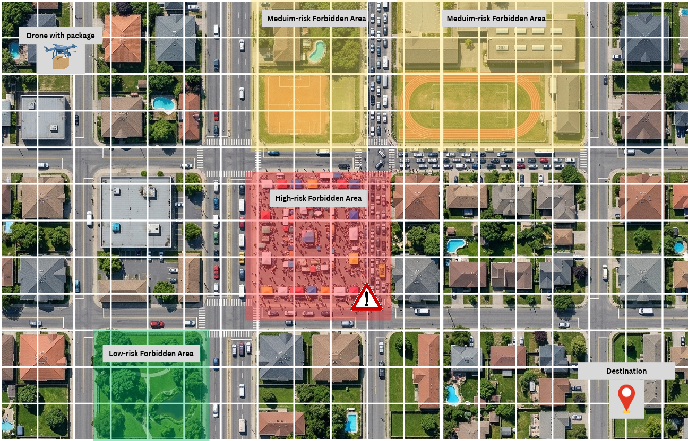
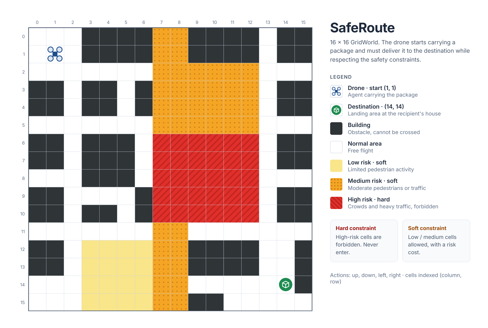
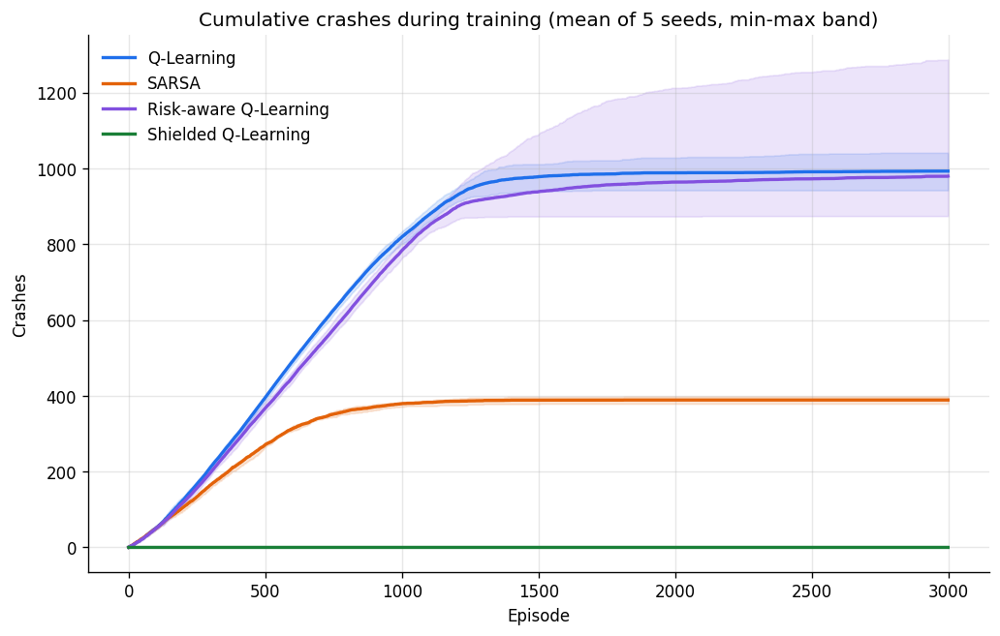
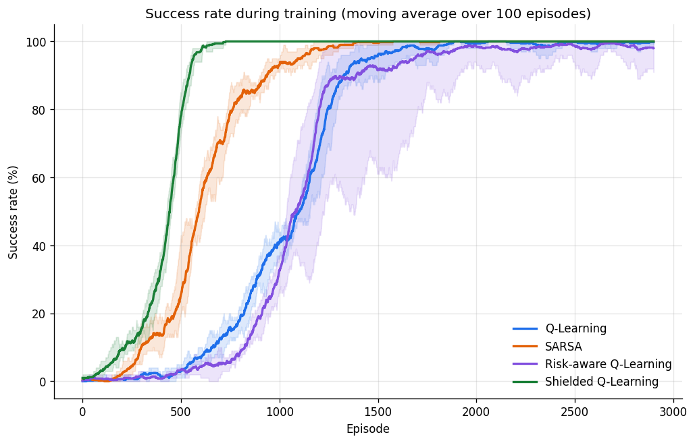
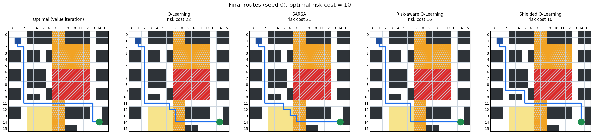
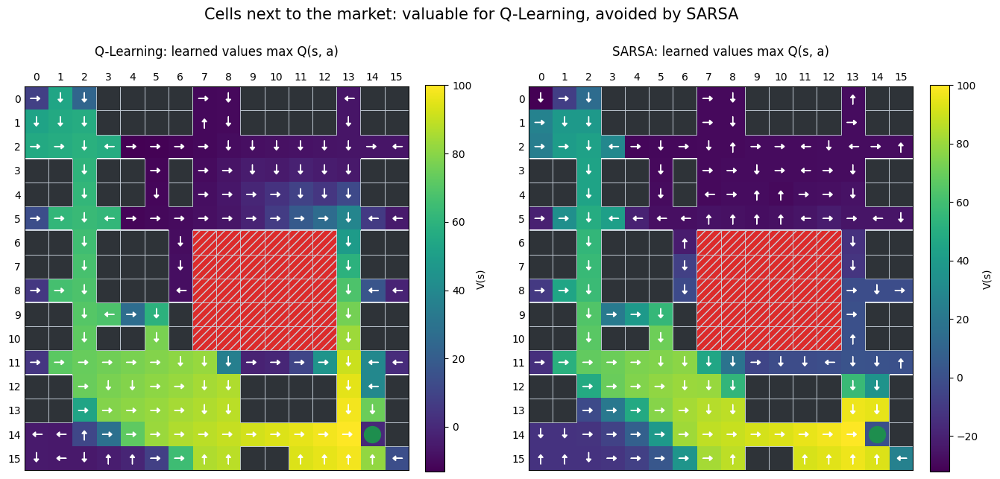

# $\color{Red}{\textsf{SafeRoute: Safe Reinforcement Learning for Autonomous Drone Delivery}}$

<div align="center">


</div>


<br>

### Table of Contents

1. [Overview](#overview)
2. [The Environment](#the-environment)
3. [MDP Formulation](#mdp-formulation)
4. [Rewards and Safety Costs](#rewards-and-safety-costs)
5. [The Agents](#the-agents)
6. [Evaluation](#evaluation)
7. [Project Structure](#project-structure)
8. [Results](#results)
9. [References](#references)

<br>


## $\color{#1F6FEB}{\textsf{Overview}}$

**SafeRoute** is a Reinforcement Learning project that simulates **an autonomous drone delivering a package in a residential area**.

- The drone must find a route to its destination while avoiding buildings, staying out of forbidden areas, and minimizing its exposure to risky zones such as crowded streets and pedestrian areas.
- The project compares four agents built around three approaches to safe navigation: **a safer learning algorithm (SARSA)**, **reward-based safety penalties**, and **safety shields**, against a **standard Q-Learning** baseline.

### $\color{#E36209}{\textsf{Research question}}$

> How can we make an RL agent learn to navigate without violating safety constraints ?

The hypothesis this project tests: **penalties teach safety after the damage is done, shields prevent it.**

<div align="center">



</div>


<br>


## $\color{#1F6FEB}{\textsf{The Environment}}$

SafeRoute uses a **16 × 16 GridWorld** representing a small residential neighborhood. The environment is **deterministic**, meaning that each action always produces the expected movement. The grid contains buildings, open streets, restricted areas, and a designated delivery location.

- The drone starts at a fixed position carrying a package. 
- At each step, it can `move up`, `down`, `left`, or `right`. 
- Its objective is to reach the delivery location while **avoiding physical obstacles** and **respecting the safety constraints** associated with different **risk zones**.

<br>

<div align="center">



</div>


<br>


## $\color{#1F6FEB}{\textsf{MDP Formulation}}$

The environment is modeled as a **Markov Decision Process (MDP)**, which defines how the agent observes its current state, chooses an action, and interacts with the environment. It provides the mathematical foundation for the Q-Learning algorithm.

The MDP is defined by the following elements:

$$\mathcal{M} = (\mathcal{S}, \mathcal{A}, P, R, \mathcal{T}, H, \gamma)$$


<div align="center">

| Symbol | Element | Definition |
| --- | --- | --- |
| $\mathcal{S}$ | State space | The drone's position $(c, r)$, with $c, r \in \lbrace 0, \dots, 15 \rbrace$: 256 possible states |
| $\mathcal{A}$ | Action space | $\lbrace \text{up}, \text{down}, \text{left}, \text{right} \rbrace$ |
| $P(s' \mid s, a)$ | Transition function | Deterministic. The next state is fully determined by the current state and the chosen action. |
| $R(s, a, s')$ | Reward function | Defined in the next section |
| $\mathcal{T}$ | Terminal states | Reaching the destination (success) or entering a high-risk cell (safety violation) |
| $H$ | Episode limit | 200 steps (timeout) |
| $\gamma$ | Discount factor | $\gamma = 0.99$ |
 
</div>

<br>

## $\color{#1F6FEB}{\textsf{Rewards and Safety Costs}}$

The reward function guides the drone's behavior by encouraging successful deliveries and discouraging unsafe navigation.

Each action results in feedback from the environment:

<div align="center">

| Event | Reward / Cost | Purpose |
|---|---:|---|
| Reach the destination | +100 | Encourage successful delivery |
| Each step taken | -1 | Encourage shorter routes |
| Enter a high-risk cell | -100 | Penalize a safety violation and end the episode |
| Enter a medium-risk cell | -5 | Discourage exposure to medium-risk areas |
| Enter a low-risk cell | -2 | Discourage exposure to low-risk areas |

</div>

Formally:

$$
R(s, a, s') =
\begin{cases}
+100 & \text{if } s' = s_{\text{goal}} \\
-100 & \text{if } s' \in \mathcal{U} \\
-1 - c(s') & \text{otherwise}
\end{cases}
\qquad
c(s') =
\begin{cases}
5 & \text{medium risk} \\
2 & \text{low risk} \\
0 & \text{otherwise}
\end{cases}
$$

where $\mathcal{U}$ is the set of high-risk cells and $c(s')$ is the risk cost.

The **base reward** is this function with $c(s') = 0$: the medium- and low-risk costs are applied only to risk-aware agents. Standard Q-Learning and SARSA do not receive these additional penalties.

<br>

## $\color{#1F6FEB}{\textsf{The Agents}}$

The project evaluates four agents to investigate how different learning algorithms and safety mechanisms affect navigation behavior.

Each agent introduces a specific change, allowing us to compare its impact against a reference agent.


<div align="center">

| # | Agent | Algorithm | Reward | Safety Shield |
|---|---|---|---|---|
| 1 | Standard Q-Learning | Q-Learning | Base reward | No |
| 2 | SARSA | SARSA | Same as Agent 1 | No |
| 3 | Risk-aware Q-Learning | Q-Learning | Base reward + risk costs | No |
| 4 | Shielded Q-Learning | Q-Learning | Same as Agent 3 | Yes |

</div>

- **Standard Q-Learning:** Learns to reach the destination using the base reward function, without additional protection against unsafe actions.
- **SARSA:** Uses a different learning algorithm while keeping the same reward function as the baseline.
- **Risk-aware Q-Learning:** Receives additional penalties for entering low- and medium-risk zones to encourage safer routes.
- **Shielded Q-Learning:** Uses a safety shield to prevent actions that would lead into high-risk zones.


<br>


### $\color{#E36209}{\textsf{Three Sources of Safety}}$

**1. Safety through the learning algorithm (agent 2).** Q-Learning is off-policy: it learns the value of the best possible action and ignores its own exploration mistakes, so it plans routes right next to high-risk cells. SARSA is on-policy: it learns from the actions it actually takes, random exploratory moves included, so it learns to keep a margin around dangerous cells. The two update rules differ by a single term:

$$\text{Q-Learning:} \quad Q(s,a) \leftarrow Q(s,a) + \alpha \left[ r + \gamma \max_{a'} Q(s',a') - Q(s,a) \right]$$

$$\text{SARSA:} \quad Q(s,a) \leftarrow Q(s,a) + \alpha \left[ r + \gamma \, Q(s',a') - Q(s,a) \right]$$

Q-Learning updates toward the best next action ($\max_{a'}$); SARSA updates toward the action $a'$ it actually takes next, exploration included.

**2. Safety through the reward (agent 3).** Risk costs $c(s')$ make crowded zones expensive, so the agent learns to prefer routes with less risk exposure.

**3. Safety through a hard rule (agent 4).** Before each action is executed, the shield checks whether it leads into a high-risk cell and, if so, blocks it. The agent can only choose among safe actions:

$$\mathcal{A}_{\text{safe}}(s) = \lbrace a \in \mathcal{A} : s'(s, a) \notin \mathcal{U} \rbrace$$

The shielded agent selects actions (ε-greedy) only from $\mathcal{A}_{\text{safe}}(s)$, so crashes are impossible, during training as well as after.

### $\color{#E36209}{\textsf{What Each Comparison Answers}}$

<div align="center">

| Comparison | Question |
| --- | --- |
| 1 vs 2 | Does on-policy learning reduce crashes during training? |
| 1 vs 3 | Does a risk cost keep the drone out of crowded zones? |
| 3 vs 4 | Does a shield outperform a penalty for the hard constraint? |

</div>

### $\color{#E36209}{\textsf{Why Only One Agent Is Shielded}}$

The shield acts independently of the learning algorithm, so applying it to the other agents would trivially give zero violations without isolating any new effect. It is paired with the risk-aware agent because that is the strongest penalty-based agent, which makes it the most demanding comparison between preventing violations (shielding) and discouraging them (penalties).

### $\color{#E36209}{\textsf{Optimal Reference}}$

Because the map is fully known, the optimal policy can be computed directly with **value iteration**, by repeating the Bellman optimality update until the values stop changing:

$$V(s) \leftarrow \max_{a} \left[ R(s, a, s') + \gamma V(s') \right]$$

It is not a learning agent; it serves as ground truth to measure how close each agent gets to the best possible route.

<br>


## $\color{#1F6FEB}{\textsf{Evaluation}}$

Each agent is trained with 5 random seeds, and results are averaged across seeds.

<div align="center">

| Metric | What it measures |
| --- | --- |
| Success rate | How often the drone reaches the destination |
| Training crashes | Total number of crashes during training (safety while learning) |
| Deployment crashes | Crashes of the final greedy policy (safety after learning) |
| Risk exposure | Number of low and medium risk cells crossed per episode |
| Path length | Average number of steps to reach the destination |
| Cumulative reward | Total reward per episode |
| Learning curves | Reward and crashes over training episodes |
| Gap to optimal | Difference between the learned route and the value iteration route |

</div>

The distinction between **training crashes** and **deployment crashes** is central to this project: an agent can end up with a perfectly safe final policy while having crashed hundreds of times to get there.

<br>

## $\color{#1F6FEB}{\textsf{Project Structure}}$

```bash
saferoute/
│   
├── maps/
│   └── saferoute_16x16.txt    # Map layout as text (one character per cell)
│
│   # Main package
├── saferoute/                 
│   ├── env/
│   │   ├── grid_map.py        # Loads the map: cell types, start, goal
│   │   └── saferoute_env.py   # Custom Gymnasium environment (rewards, risk_costs switch)
│   ├── agents/
│   │   ├── base_agent.py      # Shared logic: Q-table, epsilon-greedy policy
│   │   ├── q_learning.py      # Off-policy update
│   │   ├── sarsa.py           # On-policy update
│   │   └── shield.py          # Safe action set A_safe(s)
│   ├── planning/
│   │   └── value_iteration.py # Optimal reference policy
│   └── utils/
│       ├── metrics.py         # Success rate, crashes, risk exposure, path length
│       └── plotting.py        # Learning curves, routes drawn on the map (matplotlib)
│
├── scripts/
│   ├── train.py               # Trains the 4 agents over 5 seeds
│   ├── evaluate.py            # Computes the metrics table
│   └── plot_results.py        # Generates the figures
│
├── configs/
│   └── default.yaml           # Hyperparameters, reward values, seeds
│
├── results/                   # Generated outputs: Q-tables, logs, figures
│
├── tests/
│   ├── test_env.py            # Movement, walls, rewards, terminal states
│   └── test_shield.py         # Shielded agent never enters a high-risk cell
│
├── main.py                    # Entry point: runs the scripts
├── requirements.txt
└── README.md
```

### $\color{#E36209}{\textsf{Usage}}$

```bash
pip install -r requirements.txt

python main.py train      # Train the 4 agents over 5 seeds
python main.py evaluate   # Compute the metrics table
python main.py plot       # Generate the figures
```

<br>

## $\color{#1F6FEB}{\textsf{Results}}$

All four agents were trained for 3,000 episodes using 5 different random seeds. 

```bash
python main.py train
python main.py evaluate
python main.py plot
```


- The results show the average performance across these runs, with the standard deviation in parentheses.

<div align="center">

| Agent | Training crashes | First success (episode) | Deployment success | Deployment crashes | Path length | Route risk cost | Return | Gap to optimal |
|---|---:|---:|---:|---:|---:|---:|---:|---:|
| Q-Learning | 993 (42) | 231 (83) | 100% | 0 | 26 | 22.4 (2.6) | 52.6 (2.6) | 12.4 (2.6) |
| SARSA | 389 (7) | 147 (85) | 100% | 0 | 26 | 22.2 (0.7) | 52.8 (0.7) | 12.2 (0.7) |
| Risk-aware Q-Learning | 979 (155) | 213 (143) | 100% | 0 | 26 | 14.8 (2.4) | 60.2 (2.4) | 4.8 (2.4) |
| **Shielded Q-Learning** | **0** | **67 (72)** | 100% | 0 | 26 | **11.2 (2.4)** | **63.8 (2.4)** | **1.2 (2.4)** |

</div>

**How to read the table:**

- **Training** columns describe what happened *while learning* (ε-greedy, 3,000 episodes).
- **Deployment** columns describe the *final* greedy policy (ε = 0), flown once. One flight is enough since the environment is deterministic.
- **Return** and **gap to optimal** score every final route with the same risk-aware reward, so agents trained with different rewards can be compared. The optimal return, computed with value iteration, is 65.

The table splits into three parts, detailed below.

### $\color{#E36209}{\textsf{1. All Agents End Safe, Only the Shield Learns Safely}}$

When tested, all agents reach the goal in 26 steps, which is the shortest possible path. The difference is in **how they got there**.

- `Q-Learning` crashed into the high-risk zone **993 times** while learning, about once every three episodes.
- `SARSA` crashed **389 times**, about 60% fewer than Q-Learning. It learns from the actions it actually takes, including random ones. This helps it stay away from the market, but it does not completely prevent crashes.
- The `risk-aware agent` crashed **979 times**, almost as often as Q-Learning. This is because risk costs apply to soft-risk zones, not forbidden zones.
- The `shielded agent` **never crashed on any seed, from the very first episode**. The safety shield blocks dangerous actions before they happen, so the agent never needs to crash to learn to avoid them.

> For a real drone, each training crash is a lost vehicle or a package dropped over a crowd. This is why safety *during* learning matters, not only after it.

<div align="center">
  
</div>


### $\color{#E36209}{\textsf{2. Safety Did Not Slow Learning Down}}$

A common concern is that safety measures make learning slower. But here, the opposite happened.

- The `shielded agent` reached the goal for the first time around **episode 67**, about 3 times earlier than Q-Learning (episode 231).
- It was also the first to reach a **100% success rate**, around episode 600.

Without a safety shield, many early episodes end with a crash before the drone gets close to the goal. With the shield, the drone stays safe, giving it more chances to learn the path.

The risk-aware agent has a wider band because one seed had many more crashes (1,287) than the others (around 900). This shows that results can vary between runs, which is why we tested 5 different seeds.

<div align="center">
  
</div>


### $\color{#E36209}{\textsf{3. Risk Costs and the Shield Improve the Route}}$

All agents take the same number of steps, but some routes pass through riskier areas than others.

- **Q-Learning and SARSA** (risk cost around 22) pass through the park or medium-risk areas several times. Their reward does not distinguish between crowded and empty areas, so they treat all 26-step routes as equally good.
- **Risk-aware Q-Learning** (14.8) always limits medium-risk crossings to the unavoidable 2. However, in 4 out of 5 runs, it chooses a route through the park.
- **Shielded Q-Learning** (11.2) finds the best route in 4 out of 5 runs. It follows the street below the market and crosses the medium-risk area at its narrowest point.

Agents 3 and 4 use **the same reward**. The only difference is the safety shield.

The best route passes close to the market, where unshielded agents often crashed during training. Because of this, they rarely explored that route enough to learn its value.

> **The safety shield made it possible to explore dangerous areas without crashing. In this case, safety helped the agent learn a better route.**

<div align="center">
  
</div>


### $\color{#E36209}{\textsf{4. Why SARSA Crashes Less Than Q-Learning}}$

SARSA crashed **60% less** than Q-Learning (389 vs. 993 crashes), even though both use the same reward and have no safety shield.

The learned values help explain why. Cells near the market (column 13, column 6, and row 11) have high values for Q-Learning but low or negative values for SARSA.

- **Q-Learning (off-policy):** It learns by assuming the agent will always choose the best next action. It does not fully consider the random moves made during exploration. As a result, it considers streets near the market safe.
- **SARSA (on-policy):** It learns from the actions the agent actually takes, including random moves. It learns that staying near the market is risky and tries to keep its distance.

This explains why SARSA crashes less often. However, it cannot completely prevent crashes.

<div align="center">
  
</div>


### $\color{#E36209}{\textsf{Limitations}}$


- **The safety shield needs a known environment.** It must know where the forbidden zones are and how the drone moves. This is easy in our case because the map is known and movements are predictable. With wind or unknown danger zones, building a reliable shield becomes harder.

- **The risk-aware agent needs better exploration.** It found the best route in only 1 out of 5 runs because it did not explore one road enough to learn its value. Training longer or increasing the learning rate did not solve this. Better exploration methods, such as optimistic initialization, could help.

- **The environment is small and predictable.** Our 16 × 16 grid has only 256 states, which makes comparing the agents easier. Real-world navigation is more complex and uncertain, so methods like DQN would be more suitable.


<br>

## $\color{#1F6FEB}{\textsf{References}}$

1. Sutton, R. S., and Barto, A. G. (2018). [*Reinforcement Learning: An Introduction* (2nd ed.)](http://incompleteideas.net/book/the-book-2nd.html). MIT Press.
2. Alshiekh, M., Bloem, R., Ehlers, R., Könighofer, B., Niekum, S., and Topcu, U. (2018). [Safe Reinforcement Learning via Shielding](https://arxiv.org/abs/1708.08611). *AAAI Conference on Artificial Intelligence*.
3. García, J., and Fernández, F. (2015). [A Comprehensive Survey on Safe Reinforcement Learning](https://jmlr.org/papers/v16/garcia15a.html). *Journal of Machine Learning Research*, 16, 1437–1480.